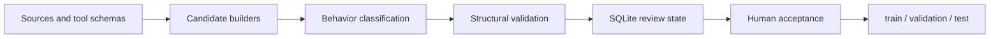

# Turkish Finance Synthetic Data Pipeline

**A review-first data pipeline for Turkish financial tool use.**

I built this project after repeatedly running into the same problem: producing a valid
tool call is easy; producing a trustworthy training example is not. A useful assistant
must know when to call a tool, when to ask a follow-up question, when a result is stale,
and when an action requires explicit confirmation.

This repository captures the pipeline that emerged from solving those failures one by
one. It is intentionally small, inspectable, and designed to be understood by both
human maintainers and coding agents.

## What this repository contains

The pipeline turns source material and tool schemas into reviewed training records through
an explicit lifecycle:



The final training contract is deliberately narrow. Every exported row contains exactly
three fields:

```json
{"id":"...","messages":[],"tools":[]}
```

Provenance, behavior labels, review status, domains, and split groups stay in the local
curation database. They are useful for building the dataset, but they do not belong in a
training example.

## Design principles

The pipeline follows a few non-negotiable rules:

- Tool and parameter names remain unchanged because they are runtime contracts.
- Current market data, bank terms, tax, and regulation questions require a tool.
- Missing dates or financially material parameters trigger clarification, not guessing.
- Side-effecting financial actions require explicit user confirmation.
- Tool failures, stale results, and source conflicts are represented honestly.
- Split assignment happens at `group_id` level to prevent scenario leakage.
- Structural validity and semantic acceptance are separate states.
- Only accepted records are eligible for export.

This is not a benchmark generator or a collection of prompt templates. It is a curation
system: candidate generation is cheap; acceptance is earned.

## Behavior coverage

The taxonomy covers 16 behaviors that appear in real tool-using conversations:

- single-tool selection, similar-tool disambiguation, unseen schemas, and parallel calls;
- finance concepts, direct natural-language answers, and deterministic calculations;
- unnecessary-tool rejection, no-suitable-tool responses, and clarification;
- retry, failure reporting, stale results, and conflicting sources;
- web search and security confirmation.

The canonical definitions live in
`.agents/skills/behavior-taxonomy/SKILL.md` and `src/tcg/models.py`. Keeping the taxonomy
close to both agent guidance and executable models makes drift easier to detect.

## Repository map

| Path | Responsibility |
|---|---|
| `src/tcg/models.py` | Message, tool-call, candidate, status, and behavior models |
| `src/tcg/pipeline.py` | Ingestion, generation, validation, review, approval, and export |
| `src/tcg/validation.py` | Record-level and collection-level invariants |
| `src/tcg/storage.py` | Local SQLite curation state |
| `src/tcg/*_cases.py` | Deterministic and source-backed candidate builders |
| `data/tools/` | Tool schemas and Turkish description overrides |
| `data/generated/` | Reviewed source records produced with a generation model |
| `.agents/skills/` | Task-specific guidance for coding agents |
| `tests/` | Behavioral and end-to-end regression coverage |

## Getting started

Python 3.11 or newer and [`uv`](https://docs.astral.sh/uv/) are required.

```bash
uv sync --extra dev
uv run python automation/harness.py validate
uv run tcg init
```

Build a small review batch:

```bash
uv run tcg ingest --limit 100
uv run tcg build --limit 100
uv run tcg validate
uv run tcg review --status valid --limit 20
```

Acceptance is explicit. Review records first, then approve selected IDs:

```bash
uv run tcg approve RECORD_ID...
uv run tcg export
uv run tcg report
```

Exports are written to `work/`. Local state and exports are ignored by Git because they
are reproducible artifacts, not source files.

## Working with coding agents

`AGENTS.md` is the entry point for coding agents. It defines the repository contract,
required reading, safety rules, and closing checks. More focused instructions live under
`.agents/skills/`.

An agent changing a behavior should inspect three things together:

1. the taxonomy entry;
2. the candidate builder and validator;
3. the behavior-level regression test.

That order matters. Most data-pipeline regressions come from changing generation without
updating the review contract, or changing validation without checking what gets exported.

## Verification

```bash
uv run python automation/harness.py validate
uv run pytest -q
uv run ruff check .
uv run ruff format --check .
uv run python automation/repair_mojibake.py --check
```

The mojibake check is intentional. Turkish text can survive JSON parsing while still
being visibly corrupted, so Unicode quality is treated as a data invariant rather than a
cosmetic concern.

## Data safety

Account references, email addresses, and IBAN-like values in the fixtures are synthetic
test data. They exist to exercise confirmation and privacy behavior; they are not customer
records or usable credentials. The repository does not require API keys for its test
suite, and credentials must never be committed.

## What is intentionally excluded

The repository does not include local SQLite state, exported dataset splits, virtual
environments, caches, credentials, or temporary files. The publishable dataset is kept
separate from the machinery used to create and review it.

That separation keeps this repository useful for its actual purpose: understanding,
testing, and improving the architecture.
